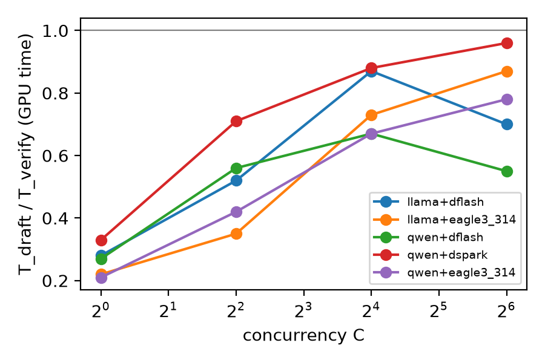
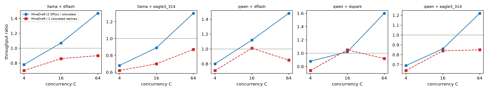

# MineDraft in SGLang on 2x H200: measure, then model

Node `06-minedraft-sglang--2xh200` · branch `research/06-minedraft-sglang/2xh200` (forked from `research-main`) · 2026-11-11 · radix `node-radixark-16-0001`, 2x H200 (NVLink).

Paper: *MineDraft: A Framework for Batch Parallel Speculative Decoding* (Tang et al., ICML 2026, arXiv 2603.18016v3). Official code is a vLLM 0.9.2 V0 plugin (`electron-shaders/MineDraft`); stage 02 ran it as-is.

## 1. What was asked, and what this run delivers

Frank asked for MineDraft reproduced in SGLang with the target on one GPU and the draft on the other, tested with EAGLE-3, DFlash and DSpark drafts, and a summary of the results. The GPUs were assigned for 2 hours, and Frank chose **measure, then model** for this run:

1. **Measured** in SGLang (this fork, `FrankLeeeee/sglang`, v0.5.23): colocated speculative decoding on one GPU for every draft type and two targets, with AR baselines, at concurrency 1-64, plus the GPU time of the target verify forward per step.
2. **Measured**: the GPU0 -> GPU1 NVLink copy of what a disaggregated draft needs each round (target hidden states of the verified rows plus token ids).
3. **Model predictions**: MineDraft throughput per draft type and concurrency, from (1) and (2), with the two-sub-batch schedule of the paper. Per-GPU normalized (MineDraft uses 2 GPUs, colocated uses 1).

**Not done**: a running MineDraft inside SGLang's scheduler. Section 6 lists what that port needs; every MineDraft number below is a prediction, labelled as such.

## 2. Setup

- Hardware: 2x H200 141 GB SXM, NVLink (P2P on), radix `node-radixark-16-0001`. Each colocated run uses one GPU; GPU0 ran the Qwen3-8B queue and GPU1 the Llama-3.1-8B queue in parallel.
- Software: SGLang fork `FrankLeeeee/sglang` (v0.5.23), torch 2.14.1+cu130. JIT builds (DeepGEMM, FlashInfer, sgl-kernel) need nvcc >= 12.9 *and* a compiler that matches the CUDA headers, so `CUDA_HOME` points at the venv's `nvidia/cu13` with `nvidia-cuda-nvcc`, `nvidia-cuda-crt` and `nvidia-nvvm` pinned to 13.0.* (the runtime headers are 13.0; nvcc 13.5 failed CCCL's compatibility check, nvvm 13.5 emitted PTX 9.5 that ptxas 13.0 rejects). This is what had blocked DFlash in stage 04.
- Models and drafts (bf16, greedy):

| Target | EAGLE-3 | DSpark | DFlash |
|---|---|---|---|
| Qwen/Qwen3-8B | Tengyunw/qwen3_8b_eagle3, (steps, topk, tokens) = (3, 1, 4) | deepseek-ai/dspark_qwen3_8b_block7 (block 7) | z-lab/Qwen3-8B-DFlash-b16 (block 16) |
| meta-llama/Llama-3.1-8B-Instruct | lmsys/sglang-EAGLE3-LLaMA3.1-Instruct-8B (3, 1, 4), config dtype set to bf16 | none public | z-lab/LLaMA3.1-8B-Instruct-DFlash-UltraChat (block 10) |

- Server flags: `--mem-fraction-static 0.8 --max-running-requests 64 --cuda-graph-max-bs-decode 64` plus the spec flags; Llama runs add `--context-length 2048/4096` because the drafts declare a shorter context than the target.
- Workload: the 90 stage-02 prompts (MT-Bench / GSM8K / HumanEval), chat template (Qwen3 with `enable_thinking=False`), 256 new tokens, closed loop at concurrency C in {1, 2, 4, 8, 16, 32, 64}, max(16, 2C) requests per point. Requests cycle through the prompt list from the start, so small C sees mostly MT-Bench prompts and C = 64 all three sets; accept lengths therefore rise with C. Compare methods at the same C only.
- Phase timing: a profiling-only `sitecustomize` (`minedraft_sglang/mdtiming/`) records CUDA events around `TpModelWorker.forward_batch_generation`, i.e. the target verify forward (T_v), for decode/verify batches, keyed by batch size. T_d = wall step - T_v, where wall step = C * tau / tok_s; T_d therefore holds the draft, the draft extend, accept/glue kernels and host gaps.
- Transfer: `xfer_bench.py`, peer copies GPU0 -> GPU1 of bf16 hidden states (1, 3 or 5 x 4096 per row) plus int64 token ids, CUDA events on the destination, 8 rotating buffers, median of 50.

## 3. Results: colocated SD in SGLang (measured, 1 GPU)

All numbers from the timing pass (`results_t/`, C in {1,...,64}); AR from `results/`. Exact match is greedy output equality vs AR at the same C (first pass), 256 tokens.

| Target | Draft | C | AR tok/s | SD tok/s | SD / AR | accept len | exact match vs AR | T_v ms | T_d ms | T_d / T_v |
|---|---|---|---|---|---|---|---|---|---|---|
| Qwen3-8B | EAGLE-3 | 1 | 194.3 | 351.3 | 1.81x | 2.22 | 0.56 | 5.24 | 1.08 | 0.21 |
| Qwen3-8B | EAGLE-3 | 4 | 603.5 | 1182.4 | 1.96x | 2.23 | 0.19 | 5.31 | 2.25 | 0.42 |
| Qwen3-8B | EAGLE-3 | 16 | 2043.3 | 3983.1 | 1.95x | 2.32 | 0.22 | 5.6 | 3.74 | 0.67 |
| Qwen3-8B | EAGLE-3 | 64 | 6867.5 | 10663.6 | 1.55x | 2.53 | 0.53 | 8.56 | 6.64 | 0.78 |
| Llama-3.1-8B | EAGLE-3 | 1 | 208.7 | 330.0 | 1.58x | 1.99 | 0.25 | 4.94 | 1.08 | 0.22 |
| Llama-3.1-8B | EAGLE-3 | 4 | 720.1 | 1166.3 | 1.62x | 1.99 | 0.19 | 5.06 | 1.78 | 0.35 |
| Llama-3.1-8B | EAGLE-3 | 16 | 2184.7 | 3534.3 | 1.62x | 2.05 | 0.31 | 5.35 | 3.91 | 0.73 |
| Llama-3.1-8B | EAGLE-3 | 64 | 7152.2 | 9246.0 | 1.29x | 2.25 | 0.42 | 8.32 | 7.25 | 0.87 |
| Qwen3-8B | DSpark | 1 | 194.3 | 408.0 | 2.1x | 2.95 | 0.88 | 5.44 | 1.79 | 0.33 |
| Qwen3-8B | DSpark | 4 | 603.5 | 1235.5 | 2.05x | 2.88 | 0.19 | 5.45 | 3.87 | 0.71 |
| Qwen3-8B | DSpark | 16 | 2043.3 | 4541.0 | 2.22x | 3.24 | 0.25 | 6.07 | 5.36 | 0.88 |
| Qwen3-8B | DSpark | 64 | 6867.5 | 10618.3 | 1.55x | 4.37 | 0.58 | 13.43 | 12.93 | 0.96 |
| Qwen3-8B | DFlash | 1 | 194.3 | 331.8 | 1.71x | 2.23 | 0.38 | 5.29 | 1.44 | 0.27 |
| Qwen3-8B | DFlash | 4 | 603.5 | 1033.4 | 1.71x | 2.26 | 0.12 | 5.6 | 3.14 | 0.56 |
| Qwen3-8B | DFlash | 16 | 2043.3 | 3061.2 | 1.5x | 2.63 | 0.31 | 8.21 | 5.53 | 0.67 |
| Qwen3-8B | DFlash | 64 | 6867.5 | 6070.0 | 0.88x | 3.78 | 0.54 | 25.65 | 14.21 | 0.55 |
| Llama-3.1-8B | DFlash | 1 | 208.7 | 460.2 | 2.21x | 2.96 | 0.75 | 5.01 | 1.42 | 0.28 |
| Llama-3.1-8B | DFlash | 4 | 720.1 | 1470.0 | 2.04x | 2.92 | 0.12 | 5.22 | 2.71 | 0.52 |
| Llama-3.1-8B | DFlash | 16 | 2184.7 | 4130.0 | 1.89x | 3.03 | 0.44 | 6.26 | 5.46 | 0.87 |
| Llama-3.1-8B | DFlash | 64 | 7152.2 | 8451.7 | 1.18x | 3.64 | 0.59 | 16.19 | 11.34 | 0.7 |

- Every draft type now runs in this SGLang build, DFlash included. At C = 1 the best is DFlash on Llama (2.21x AR) and DSpark on Qwen3-8B (2.10x); EAGLE-3 gives 1.58-1.81x.
- Speedups fall at C = 64 (1.18-1.55x); Qwen3-8B + DFlash (block 16, 1024 verify rows) drops below AR (0.88x): its verify takes 25.7 ms against 8.6 ms for EAGLE-3.
- T_d / T_v stays below 1 everywhere (0.21-0.33 at C = 1, 0.55-0.96 at C = 64). With hidden-state drafts the target verify is the larger half of every step.
- Exact match vs AR is 0.12-0.88. Stage 03 showed SGLang SD matches AR 90/90 under deterministic inference, so this is bf16 batch-shape numerics; it was not re-checked here.



## 4. Results: GPU0 -> GPU1 transfer (measured)

`xfer.json`. Peer copy of bf16 hidden states plus token ids, NVLink, median of 50:

| rows | 3 x 4096 (EAGLE-3) | 5 x 4096 (DFlash / DSpark) |
|---|---|---|
| 1-32 | 0.039 ms | 0.039 ms |
| 64 | 0.051 ms | 0.052 ms |
| 256 | 0.052 ms | 0.074 ms |
| 1024 | 0.096 ms | 0.147 ms (42 MB, 285 GB/s) |

A whole round's worth of hidden states (up to 32 x 16 = 512 rows) costs <= 0.09 ms, about 1% of a verify. The copy is launch-latency bound below ~128 rows. Not included: cross-process synchronization (NCCL send/recv would add tens of microseconds).

## 5. Results: MineDraft predictions (model, not measured)

Model (`minedraft_sglang/analyze.py`): at total concurrency C, two cohorts of m = C/2; GPU0 verifies one while GPU1 drafts the other, so one cohort step costs max(T_v(m), T_d(m) + X(m)), and a round (both cohorts advance) costs twice that for C x tau tokens. T_v and T_d are the measured colocated values at concurrency m; X is the measured copy for m x (k+1) rows. All host gaps are put on the draft side and assumed hidden, which favours MineDraft.

| Target | Draft | C | sub-batch m | step (ms) = max(T_v(m), T_d(m)+X) | **MineDraft tok/s (pred.)** | vs colocated 1 GPU | per GPU vs colocated | vs 2 colocated replicas (2 GPUs) |
|---|---|---|---|---|---|---|---|---|
| Qwen3-8B | EAGLE-3 | 4 | 2 | 5.44 (verify-bound; X = 0.039) | 821.2 | 0.69x | 0.35x | 0.64x |
| Qwen3-8B | EAGLE-3 | 16 | 8 | 5.45 (verify-bound; X = 0.039) | 3409.7 | 0.86x | 0.43x | 0.84x |
| Qwen3-8B | EAGLE-3 | 64 | 32 | 6.23 (verify-bound; X = 0.051) | 13018.1 | 1.22x | 0.61x | 0.85x |
| Llama-3.1-8B | EAGLE-3 | 4 | 2 | 5.0 (verify-bound; X = 0.039) | 797.0 | 0.68x | 0.34x | 0.62x |
| Llama-3.1-8B | EAGLE-3 | 16 | 8 | 5.2 (verify-bound; X = 0.039) | 3150.5 | 0.89x | 0.45x | 0.7x |
| Llama-3.1-8B | EAGLE-3 | 64 | 32 | 6.0 (verify-bound; X = 0.051) | 12003.3 | 1.3x | 0.65x | 0.87x |
| Qwen3-8B | DSpark | 4 | 2 | 5.32 (verify-bound; X = 0.039) | 1081.6 | 0.88x | 0.44x | 0.74x |
| Qwen3-8B | DSpark | 16 | 8 | 5.6 (verify-bound; X = 0.052) | 4630.7 | 1.02x | 0.51x | 1.05x |
| Qwen3-8B | DSpark | 64 | 32 | 8.23 (verify-bound; X = 0.074) | 17001.6 | 1.6x | 0.8x | 0.92x |
| Qwen3-8B | DFlash | 4 | 2 | 5.44 (verify-bound; X = 0.039) | 830.3 | 0.8x | 0.4x | 0.71x |
| Qwen3-8B | DFlash | 16 | 8 | 6.1 (verify-bound; X = 0.051) | 3442.7 | 1.12x | 0.56x | 1.01x |
| Qwen3-8B | DFlash | 64 | 32 | 13.5 (verify-bound; X = 0.086) | 8958.9 | 1.48x | 0.74x | 0.85x |
| Llama-3.1-8B | DFlash | 4 | 2 | 5.1 (verify-bound; X = 0.039) | 1144.1 | 0.78x | 0.39x | 0.7x |
| Llama-3.1-8B | DFlash | 16 | 8 | 5.46 (verify-bound; X = 0.051) | 4429.9 | 1.07x | 0.54x | 0.86x |
| Llama-3.1-8B | DFlash | 64 | 32 | 9.35 (verify-bound; X = 0.086) | 12443.0 | 1.47x | 0.74x | 0.9x |



**What the model says**

- **The schedule is verify-bound in every case.** T_d(m) + X(m) < T_v(m) everywhere, so the draft GPU idles and a round costs two half-batch verifies on GPU0.
- **Small batch: MineDraft loses even before normalizing by GPU (0.68-0.88x at C = 4).** The verify is memory-bound and flat in rows (4.9-5.6 ms from 1 to 8 requests), so two half-batch verifies cost almost twice one full-batch verify. This is the same weight-reread effect that killed two-batch ping-pong on one GPU in stage 04, now on the target GPU alone.
- **Large batch: MineDraft beats a single colocated GPU by 1.22-1.60x at C = 64,** because the verify is FLOP-bound there and halving the batch roughly halves it. Per GPU that is 0.61-0.80x, and against the fair 2-GPU baseline (two colocated replicas at C/2 each) it is 0.85-0.92x. The only points at or above the replicas are C = 16 with Qwen3-8B (DSpark 1.05x, DFlash 1.01x), which are within run-to-run noise (section 7).
- **Why this differs from the paper.** MineDraft's gains (+39-65% average throughput, up to +76%, Fig. 3) come from standalone draft LMs (Qwen3-0.6B-4B, Llama-3.1-8B for a 70B target) whose draft time is close to the verify time, on L40S and H100 with TP4 targets. Its best case is T_d = T_v (bound 2x, Thm. 1). With SGLang's hidden-state drafts on an 8B target, T_d / T_v is 0.2-0.9, so there is little draft time to hide, and splitting the batch costs more than the overlap saves. The paper's own EAGLE result (+7.5%) points the same way.

## 7. Caveats

- **Short runs.** Each point is 16-128 requests of 256 tokens (2-18 s). Two passes of the same config differ by up to ~20% at C = 64 (Qwen3-8B EAGLE-3: 8.9K vs 10.7K tok/s), which includes closed-loop drain and prefill. Read ratios below ~1.1x as ties.
- **Prompt mix changes with C** (section 2), so accept length rises with C; methods are compared at equal C only.
- **T_d is a residual** (wall step - T_v). It includes host time, which a real two-GPU system pays on both sides, so the MineDraft predictions are optimistic.
- **Llama-3.1-8B EAGLE-3** accepts 1.99-2.25 tokens per verify here vs 2.87 in stage 02 with the same head (fp16 checkpoint loaded with its config set to bf16, newer SGLang). Not investigated.
- **No deterministic-mode check** this run; exact-match numbers are bf16 numerics.
- **Not covered**: 70B-class targets (the regime where the paper and stage 04's proposal C expect a dedicated draft GPU to help); standalone small-LM drafts; latency/SLO metrics; a running implementation.

## 8. Conclusions and next steps

- Measured: in SGLang on H200 with an 8B target, EAGLE-3, DSpark and DFlash drafts all cost less than the verify (T_d / T_v 0.2-0.96), and moving their hidden states between GPUs costs ~0.04-0.15 ms per round.
- Predicted: MineDraft with the draft on its own GPU is verify-bound for all three draft types; it loses at small batch (0.68-0.88x of one colocated GPU at C = 4) and, at C = 64, beats one GPU (1.22-1.60x) but not two colocated replicas on the same two GPUs (0.85-0.92x).
- Recommendation: do not spend the multi-day port on 8B targets with hidden-state drafts. If MineDraft is pursued, test where its assumption holds, T_d close to T_v: a 70B TP4 target with a standalone 1B-8B draft (stage 03: T_d / T_v = 0.74 for SSD's draft) or block drafts with large blocks at high C. A quick check before porting is the same measure-then-model pass on 70B TP4 + 1 draft GPU.

## 9. Reproduce

Code in `minedraft_sglang/` on this branch; raw results in `minedraft_sglang/data/`.

```bash
# on the node, after radix-up (project sglang)
export CUDA_HOME=~/sglang/.venv/lib/python3.11/site-packages/nvidia/cu13
uv pip install --python ~/sglang/.venv/bin/python "nvidia-cuda-nvcc==13.0.*" "nvidia-cuda-crt==13.0.*" "nvidia-nvvm==13.0.*"
RESDIR=results_t CONC=1,2,4,8,16,32,64 ./run_baselines.sh 0 30000 specs_qwen.txt   # GPU0
RESDIR=results_t CONC=1,2,4,8,16,32,64 ./run_baselines.sh 1 30001 specs_llama.txt  # GPU1
./run_baselines.sh 0 30000 specs_qwen.txt   # AR + first pass into results/
python xfer_bench.py xfer.json
python analyze.py data && python make_figures.py data   # summary.json, figures/
```

`run_baselines.sh` exports `PYTHONPATH=~/mdtiming` and `MD_TIMING_OUT` so the timing `sitecustomize` loads in the server processes.


## 6. What a real MineDraft port into SGLang needs

The measured pieces show the schedule is easy to state and the hard part is state ownership:

1. **Draft worker on its own device.** SGLang's spec workers (EAGLE-3, DFlash, DSpark) share the target's `req_to_token_pool` and allocator and build the draft `ModelRunner` on the target's GPU. The draft needs its own KV pool, its own request-to-slot table and its own CUDA graphs on GPU1, keyed by the same request ids.
2. **Hidden-state relay.** All three drafts condition on target hidden states (EAGLE-3: 3 layers; DFlash/DSpark: 5 layers x 4096). After each verify, GPU0 sends the accepted rows' hidden states and the accepted/bonus tokens to GPU1; GPU1 sends the next drafts back. Measured cost: <= 0.15 ms per round for up to 1024 rows (section 4), so communication is not the obstacle, unlike the 50-58% share of step latency that the paper reports at k = 1 (its Table 1).
3. **Two-cohort batch manager.** As in the paper's Sec. 5.1: each request carries a cohort id; the scheduler alternates which cohort verifies, admits new requests into the smaller cohort, and falls back to plain SD when one cohort is empty. SGLang's overlap scheduler already pipelines one batch ahead, so the cohort switch has to happen at the `run_batch` / `process_batch_result` boundary.
4. **KV over-allocation skip.** The cohort that is drafting must not get verify KV slots that step (the paper's `has_deferred`).
5. **Draft-only prefill.** New requests must prefill on both GPUs; DFlash/DSpark materialize the prompt's target hidden states into the draft KV at prefill, which becomes a large transfer at prefill time.

Estimated effort: several days for one draft type, which is why this run stopped at measure-then-model.

